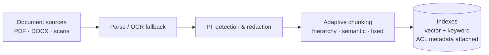
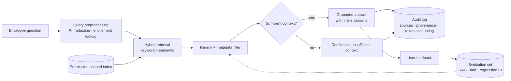

# Process-level modeling

The system is modeled as two high-level processes: one for bringing documents in, one for answering questions under governance.

These diagrams describe required behavior from [REQUIREMENTS.md](../../REQUIREMENTS.md). They do not record architecture decisions; those live in [ADRs](../../ADR/README.md).

## Ingestion process

## Query and answer process

## To be added

- Swimlane detail for both processes, including ownership per step.
- Exception paths: OCR failure, poisoned or malformed document, retrieval outage, model timeout, budget exhaustion, permission-denied query.
- Retry, escalation, and dead-letter handling.
- Editable draw.io versions: `<topic>-<name>.xml` with `<topic>-<name>.png` renders, per the [drawing conventions](../README.md#drawing-conventions).
