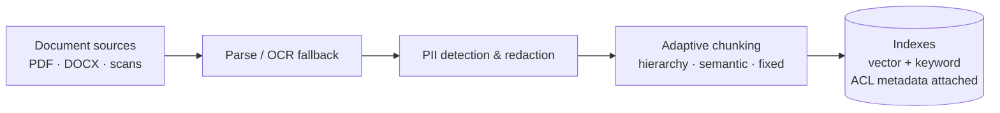
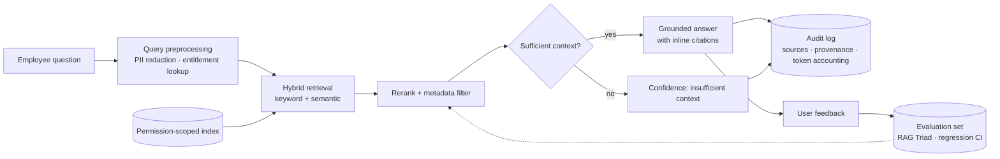

# Fintech RAG for Financial Regulations and Contracts

**This is a showcase repository: a portfolio-grade demonstration of production-depth RAG, not a production system and not affiliated with any institution. All documents and data used here are synthetic.**

This project explores what it actually takes to run retrieval-augmented generation for a regulated financial institution. The scenario: a Swiss private bank or insurance group needs an internal assistant that answers employee questions across 50,000+ policy PDFs, scanned contracts, and regulatory circulars. Access must be strict (an adviser in Geneva must never retrieve Zürich private-banking documents), every answer must cite its source passages, and every answer must leave an audit trail. The keyword search used today returns too many false positives and offers no traceable reasoning.

The repository covers the full path from document ingestion to a governed answer: OCR and parsing, adaptive chunking, hybrid retrieval with permission-aware filtering, grounded generation with inline citations, evaluation discipline, and the compliance, latency, and cost controls that separate a demo from a system a bank could operate. It is intended to demonstrate RAG at production depth (not toy depth), large-file handling, evaluation discipline, compliance thinking, and reasoning about QPS and cost in AI systems.

## Requirements

Requirements are described at a business and system level. Concrete libraries and cloud services are deliberately left to the architecture sections.

### Functional requirements (user stories)

- **Ingestion**: As a records administrator, I want PDF, DOCX, and scanned documents ingested with OCR fallback, so that all policy, contract, and regulatory sources are searchable, including poorly scanned originals.
- **Adaptive chunking**: As a retrieval engineer, I want chunking to respect section hierarchy and to switch between fixed, semantic, and hybrid strategies based on document type, so that retrieved passages stay coherent, citable, and within context-token limits.
- **Hybrid retrieval**: As an employee, I want keyword and semantic retrieval combined with a reranking step, so that exact regulatory terminology and paraphrased questions are both handled well.
- **Permission-aware retrieval**: As an access-control owner, I want metadata filters to enforce role-based access at query time, so that the Geneva adviser can never receive Zürich private-banking documents.
- **Grounded answers with citations**: As an employee, I want generated answers with inline citations to the source passages, so that I can verify every claim before acting on it.
- **Insufficient-context fallback**: As a risk-aware reader, I want an explicit "confidence: insufficient context" response instead of a plausible guess, so that thin evidence never becomes fabricated policy.
- **Provenance and audit trail**: As a compliance officer, I want every answer logged with its sources, requester, and model/prompt version, so that any answer can be reconstructed after the fact.
- **Feedback loop**: As a reviewer, I want to mark answers helpful or not helpful, so that feedback is stored and feeds the evaluation set.

### Non-functional requirements

- **Latency and streaming**: P95 time-to-first-token ≤ 3 s; responses are streamed, never returned as a blocking dump.
- **Throughput and graceful degradation**: Per-user and per-tenant retrieval quotas, token-bucket throttling of LLM calls, and degradation to retrieval-only mode when the budget is exhausted.
- **Privacy and GDPR**: PII detection and redaction before embedding and before any LLM call; data residency in the EU or Switzerland.
- **Local and private deployment**: The design must support private or locally hosted LLM deployments and enterprise-grade vector storage for scenarios where data may not leave the institution's boundary.
- **EU AI Act readiness**: Transparency notice, model card, and an answer provenance log for every interaction.
- **Security**: Prompt-injection defenses through input/output filtering and instruction hierarchy, strict tenant isolation, and encryption of the vector store at rest.
- **Cost control**: Per-query token accounting, cached embeddings, and cheaper models for low-risk queries.
- **Context management**: Token budgets are enforced end to end, sliding-window overlap is used where document structure is weak, and grounding plus the insufficient-context fallback are the primary defenses against hallucination.

### Evaluation gate (definition of done)

The project is not considered done until the following pass on a 100-question golden set:

| Metric | Threshold |
| --- | --- |
| Faithfulness (groundedness) | ≥ 0.90 |
| Answer relevancy | ≥ 0.85 |
| Context precision | ≥ 0.80 |

These map to the RAG Triad: context relevance, groundedness, and answer relevance. The evaluation suite runs in CI on every prompt change, alongside a regression set built from the user feedback loop.

## Process-level modeling

The system is modeled as two high-level processes: one for bringing documents in, one for answering questions under governance.

### Ingestion process

### Query and answer process

_Detailed process model (swimlanes, exception paths, retry and escalation handling): to be added._

## Architecture

Three deployment architectures are planned. Each will document its components, trust boundaries, and end-to-end request flow.

### Azure

_Planned direction: Azure OpenAI Service, Azure AI Search, document parsing with OCR, vector storage, Terraform, and containerized deployment._

_Architecture diagram and flow: to be added._

### AWS

_Planned direction: Amazon Bedrock, Amazon OpenSearch, document OCR, vector storage, Terraform, and containerized deployment._

_Architecture diagram and flow: to be added._

### Kubernetes

_Planned direction: portable containerized deployment across providers or on-premises, with autoscaling, workload isolation, and policy enforcement for tenant boundaries._

_Architecture diagram and flow: to be added._

## Showcase

_To be added: demo video or GIF, screenshots of the assistant with inline citations, a sample insufficient-context response, the evaluation dashboard, and benchmark results for latency, retrieval quality, and cost._
