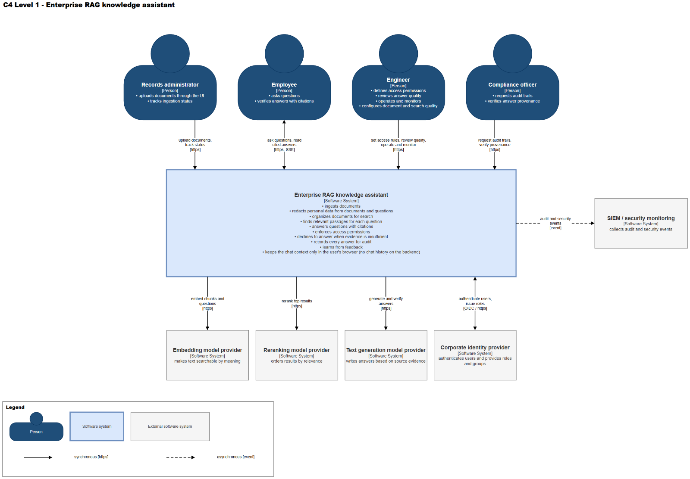
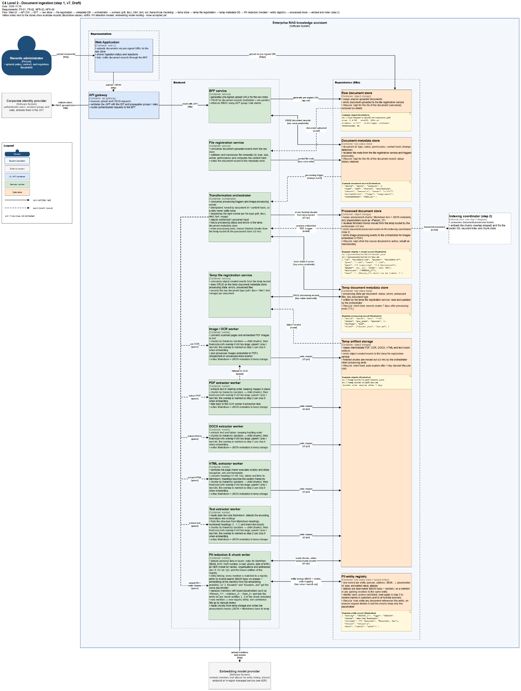
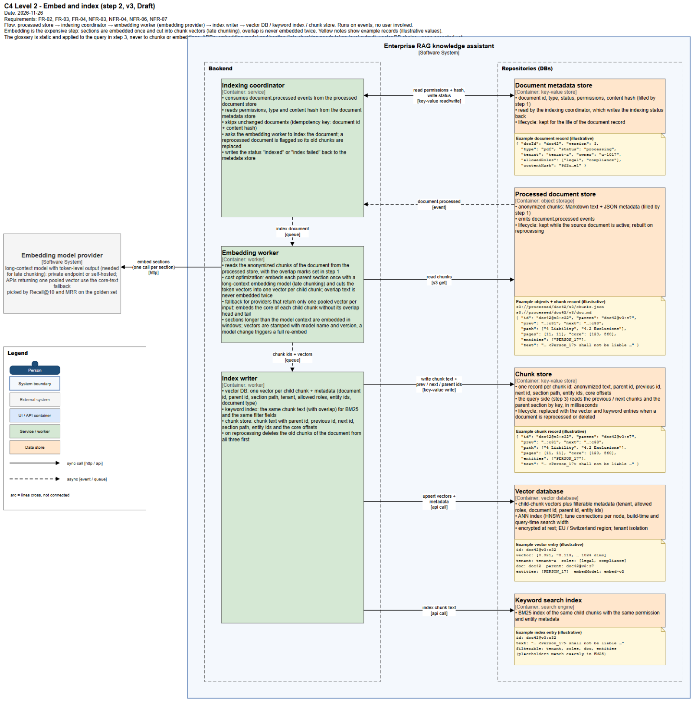
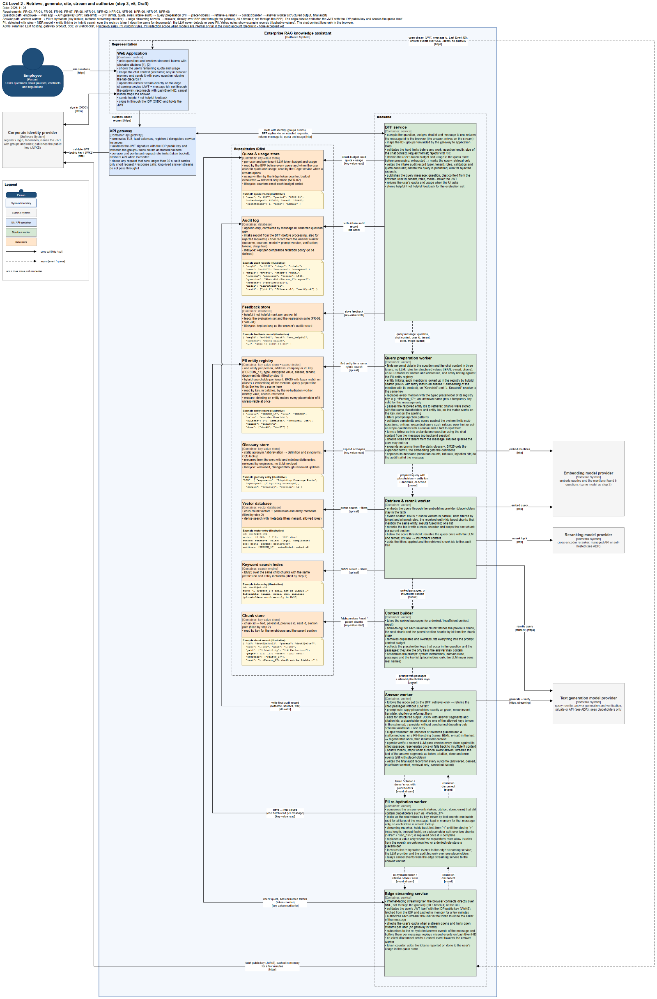

# Fintech RAG for Financial Regulations and Contracts

**This is a showcase repository: a portfolio-grade demonstration of production-depth RAG, not a production system and not affiliated with any institution. All documents and data used here are synthetic.**

This project explores what it actually takes to run *RAG* (retrieval-augmented generation) for a regulated financial institution. The scenario: a **Swiss private bank or insurance group** needs an internal assistant that answers employee questions across **50,000+ policy PDFs, scanned contracts, and regulatory circulars**. Access must be **strict** (an adviser in Geneva must never retrieve Zürich private-banking documents), **every answer must cite its source passages**, and **every answer must leave an audit trail**. The keyword search used today returns too many false positives and offers **no traceable reasoning**.

The repository covers the full path from document ingestion to a governed answer: *OCR* and parsing, adaptive chunking, *hybrid retrieval* with permission-aware filtering, grounded generation with *inline citations*, evaluation discipline, and the **compliance, latency, and cost controls** that separate a demo from a system a bank could operate. It is intended to demonstrate **RAG at production depth (not toy depth)**, large-file handling, evaluation discipline, compliance thinking, and reasoning about *QPS* and cost in AI systems.

## Start here

| Document | What it covers |
| --- | --- |
| **[ADR/README.md](ADR/README.md)** | **The list of architecture decisions. Start here for decisions.** |
| [REQUIREMENTS.md](REQUIREMENTS.md) | Functional and non-functional requirements, with completion checkboxes. |
| [ARCHITECTURE.md](ARCHITECTURE.md) | System-wide architecture summary and the decision register. |
| [c4-architecture/](c4-architecture/) | C4 architecture drawings and business flows (draw.io XML). |
| [src/README.md](src/README.md) | Planned application layout. |
| [infra/README.md](infra/README.md) | Planned infrastructure layout. |
| [AGENTS.md](AGENTS.md) | How AI agents work in this repository. |

## C4 architecture

The architecture follows the C4 model. The table below is the drawing index — each PNG render is committed next to its `.drawio` source, and the drawing standard lives in [.claude/commands/create-c4.md](.claude/commands/create-c4.md). Open a `.drawio` file in [diagrams.net](https://app.diagrams.net) (File → Open from → URL, with the file's raw link) or with the VS Code drawio extension to see or edit the source diagram.

| Title | Description | Diagram |
| --- | --- | --- |
| System context (Level 1, v3) | Who uses the assistant and which external systems it depends on |  <a href="c4-architecture/lvl1_v3_system_context.drawio">lvl1_v3_system_context.drawio</a> |
| Document ingestion (Level 2 step 1, v7) | Upload, registration, hierarchical chunking, and the hand-off to embedding |  <a href="c4-architecture/step1_lvl2_v7_document-ingestion.drawio">step1_lvl2_v7_document-ingestion.drawio</a> |
| Embed and index (Level 2 step 2, v3) | Event-driven embedding and index writes to the vector DB, keyword index, and chunk store |  <a href="c4-architecture/step2_lvl2_v3_embed-and-index.drawio">step2_lvl2_v3_embed-and-index.drawio</a> |
| Retrieve, generate, cite, stream, authorize (Level 2 step 3, v5) | The question and answer path: retrieval, reranking, generation, citations, and SSE streaming |  <a href="c4-architecture/step3_lvl2_v5_retrieve-generate-stream.drawio">step3_lvl2_v5_retrieve-generate-stream.drawio</a> |
| Project walkthrough (PDF) | Hand-drawn flows and the project walkthrough used as drawing input | <a href="c4-architecture/project%201%20-%20rag%20knowledge%20assistant%20fo%20regulation%20docs-2026-11-14-19-06.pdf">project 1 - rag knowledge assistant fo regulation docs-2026-11-14-19-06.pdf</a> |

## Showcase

_To be added: demo video or GIF, screenshots of the assistant with inline citations, a sample insufficient-context response, the evaluation dashboard, and benchmark results for latency, retrieval quality, and cost._

## License

Released under the [MIT License](LICENSE).
